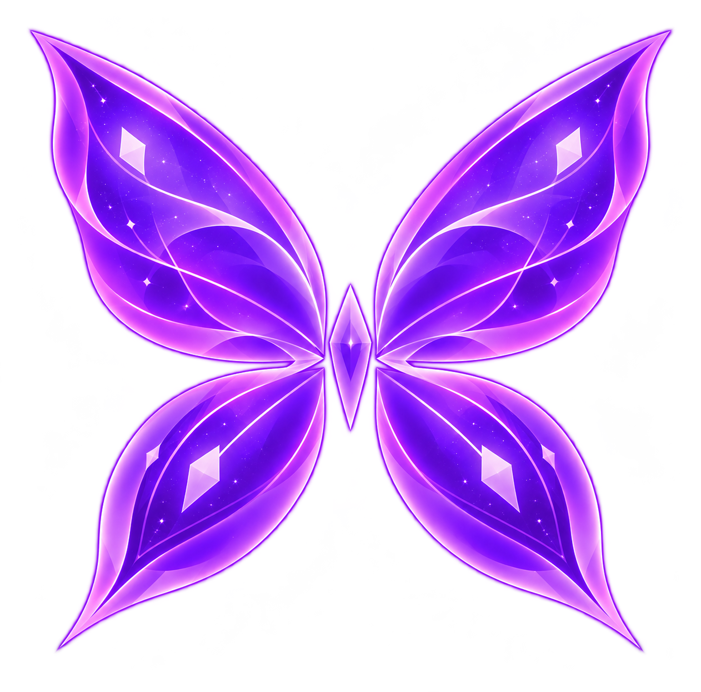

# Shireia

<p align="center">
  
</p>

**Emulador experimental de Nintendo Switch, independente e de código aberto.** O Shireia combina uma interface própria em Qt Quick/QML com um núcleo baseado em componentes herdados do Suyu/Yuzu.

**Desenvolvedor responsável:** Willlchrist, com assistência de ferramentas de inteligência artificial. O projeto está em desenvolvimento experimental.

## Recursos principais

- Biblioteca local de arquivos NRO, NSO, NSP e XCI, com busca, favoritos, histórico, capas locais e leitura de metadados quando disponíveis.
- Configurações globais e por jogo, incluindo opções gráficas e de sessão.
- Entrada por teclado e SDL2, remapeamento e perfis para até dois jogadores locais.
- Menu rápido, métricas opcionais, captura de imagem, registros de sessão e exportação de diagnóstico sanitizado.
- Importação local de mods LayeredFS/ExeFS e cheats de texto vinculados a Title ID e Build ID.
- Gerenciamento de cache de shaders/pipelines e instalação local de updates e DLCs NSP por meio das APIs do núcleo.
- Assistente para configurar firmware, chaves e pastas da biblioteca fornecidos pelo usuário.

O Shireia não distribui jogos, firmware ou chaves. Consulte a [matriz de recursos e validação](docs/RECURSOS_E_VALIDACAO.md) para detalhes sobre disponibilidade e cobertura dos testes.

## Compatibilidade e limitações

A integração foi exercitada com o homebrew 2048 1.1.0, que apresentou quadros na interface. Testes com alguns conteúdos NSP/XCI tiveram resultados diferentes; identificar um arquivo ou iniciar seu carregamento não demonstra que ele seja jogável. Não há alegação de compatibilidade geral com jogos comerciais.

O projeto ainda está em desenvolvimento. Algumas opções gráficas precisam de validação mais ampla; saída de áudio audível e execução em outros computadores também não foram validadas suficientemente. As avaliações de compatibilidade são registradas pelo usuário e não inferidas automaticamente.

## Requisitos conhecidos

### Execução

- Windows x64.
- GPU e drivers com suporte a Vulkan para o renderizador do núcleo e Direct3D 11 para a superfície compartilhada do frontend.
- Executáveis, DLLs, plugins Qt, imports QML e bibliotecas correspondentes. Ainda não há instalador.
- Firmware local e chaves apropriadas podem ser necessários para determinados conteúdos. O Shireia não inclui esses arquivos.

As fontes compartilhadas do sistema são lidas do firmware local instalado pelo usuário; não há fallback tipográfico embutido. Firmware incompleto pode deixar alguns textos sem fontes. Não há benchmarks suficientes para especificar requisitos mínimos ou recomendados de CPU, memória, GPU ou armazenamento.

### Compilação

A compilação Windows x64 foi validada com CMake 4.4.4, Ninja 1.13.2, GCC 16.2.0 UCRT64, Qt 6.11.2 e SDL2 2.32.10. Essas versões descrevem o ambiente validado, não uma matriz oficial de suporte. Instruções de instalação e dependências estão em [Compilação](docs/COMPILACAO.md).

## Compilação e execução

O snapshot do núcleo está em `third_party/suyu/`. Instale os requisitos de MSYS2/UCRT64 e Qt descritos em [docs/COMPILACAO.md](docs/COMPILACAO.md), então execute no PowerShell:

```powershell
powershell -ExecutionPolicy Bypass -File scripts/build.ps1
powershell -ExecutionPolicy Bypass -File scripts/run.ps1
```

O primeiro build obtém as dependências de código-fonte fixadas no manifesto CPM. O script prepara uma execução local, mas não gera instalador ou pacote de release. A documentação também descreve builds em diretório isolado e compilação apenas do frontend.

## Arquitetura

O frontend Qt Quick/QML gerencia a biblioteca e as preferências. Um backend C++ supervisiona `ShireiaCore.exe`, integrado a `Core::System` do Suyu. Os processos trocam mensagens JSON por um socket local Qt. O núcleo renderiza em Vulkan; o frontend apresenta os quadros em uma superfície D3D11 compartilhada. A entrada SDL2 é coletada pelo frontend e enviada ao HID virtual do núcleo.

Mais detalhes: [Arquitetura e fluxos](docs/ARQUITETURA_E_FLUXOS.md).

## Documentação

- [Índice da documentação](docs/README.md)
- [Recursos, validação e limitações](docs/RECURSOS_E_VALIDACAO.md)
- [Compilação](docs/COMPILACAO.md)
- [Configuração de recursos do sistema](docs/SYSTEM_RESOURCES.md)
- [Licenças e publicação](docs/LICENCAS_E_PUBLICACAO.md)
- [Inventário de dependências e licenças](docs/DEPENDENCIAS_E_LICENCAS.md)
- [Patches downstream do Suyu](third_party/suyu/SHIREIA-PATCHES.md)
- [Política de distribuição](docs/POLITICA_DE_DISTRIBUICAO.md)

## Licenças e créditos

O núcleo herdado do Suyu/Yuzu e os componentes de terceiros mantêm suas próprias licenças, copyrights e avisos. Consulte [`third_party/NOTICES.md`](third_party/NOTICES.md), [`third_party/licenses/`](third_party/licenses/) e os registros dos [patches downstream](third_party/suyu/SHIREIA-PATCHES.md). O Shireia não reivindica autoria sobre o código herdado.

O [`LICENSE`](LICENSE) contém a GNU GPL versão 3. A autorização de Willlchrist para GPL-3.0-or-later cobre contribuições originais elegíveis somente na medida dos direitos detidos; a licença raiz não substitui as licenças e avisos aplicáveis ao Suyu/Yuzu ou a terceiros. A delimitação de autoria e as questões ainda em revisão estão descritas em [Licenças e publicação](docs/LICENCAS_E_PUBLICACAO.md) e [Contribuições e autoria](docs/CONTRIBUICOES_E_AUTORIA_PENDENTE.md).

O logotipo e a identidade visual são tratados separadamente das licenças de software. Sua procedência e os limites das declarações de direitos estão em [`assets/brand/NOTICE.md`](assets/brand/NOTICE.md). O Shireia não é afiliado, patrocinado ou endossado pela Nintendo, pelo Suyu ou pelo Yuzu.

## Contribuição

Consulte [`CONTRIBUTING.md`](CONTRIBUTING.md) antes de propor alterações. Preserve os avisos existentes e identifique claramente qualquer código ou recurso de terceiros.
