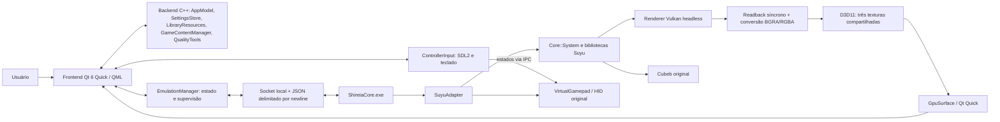
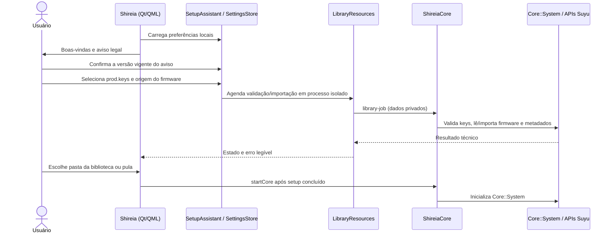
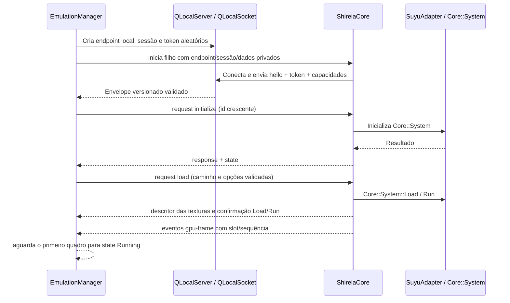
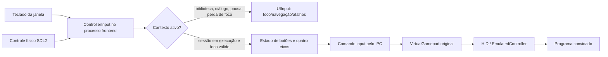
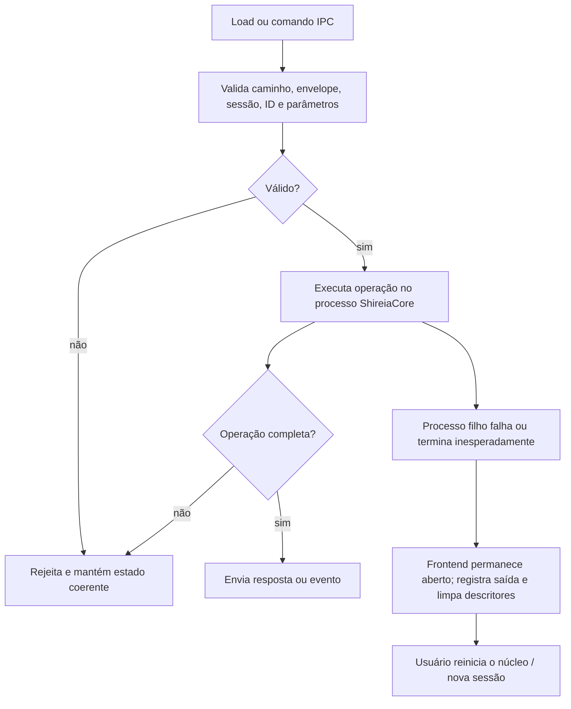

# Arquitetura e fluxos

Este documento descreve os caminhos implementados neste repositório. O núcleo Suyu é compilado a partir das fontes fixadas em `third_party/suyu/` e integrado por suas APIs e bibliotecas. O Shireia não reimplementa CPU, GPU, serviços de sistema, filesystem, HID ou mixer de áudio.

## Componentes

O processo principal mantém a janela e a interface. `EmulationManager` inicia o filho com diretório de dados privado, cria endpoint local de IPC e valida o handshake. `ShireiaCore` inicializa `Core::System`, configura caminhos e integra os callbacks de entrada, áudio e quadros. As tarefas de leitura de metadados/importação também usam processo isolado para limitar bloqueios do frontend.

## Primeira inicialização e sessão

As chaves e o firmware são selecionados pelo usuário e não estão incluídos. A seleção e importação não examinam procedência. A pasta da biblioteca é opcional; o assistente exige a confirmação do aviso e a validação técnica das chaves e firmware para concluir.

## Comunicação frontend ↔ núcleo

O envelope contém versão do protocolo, sessão, tipo e ID. Cada quadro é um objeto JSON compacto terminado em `\n`; o tamanho máximo é 64 KiB. O canal valida JSON, sessão, sequência de IDs, campos, capacidades e eventos GPU. O token é removido do ambiente de processos depois de recebido. IPC é local à máquina e não envia dados a serviços externos.

Comandos incluem inicialização, estado, identificação, carga, entrada, pausa, retomada, volume, velocidade, opções de apresentação, captura de desempenho e parada. Identificação (`Loader::IdentifyFile`) não é `Load` e não inicia a execução.

## Pipeline gráfico e captura

```mermaid
flowchart LR
    Game[Programa convidado] --> Core[Core::System]
    Core --> Vulkan[Renderizador Vulkan headless]
    Vulkan --> Composite[Composição do quadro]
    Composite --> Sync[Readback síncrono / espera do scheduler]
    Sync --> CPU[Buffer CPU + conversão BGRA para RGBA]
    CPU --> Upload[UpdateSubresource em D3D11]
    Upload --> Slots[Três texturas D3D11 compartilhadas + keyed mutex]
    Slots --> Import[Importação das texturas pelo Qt Quick D3D11]
    Import --> Present[GpuSurface apresenta imagem recortada da janela]
    Present --> Shot[QImage capturada e salva como PNG]
```

O filho publica a saída real do compositor headless. O produtor e o consumidor trocam a propriedade dos buffers com keyed mutex; IPC só anuncia geração, slot e sequência. O Qt seleciona o quadro pronto mais recente e descarta anúncios ultrapassados. A fila é limitada a três texturas e não acumula quadros quando a interface não consome.

Esse caminho possui cópia GPU→CPU e upload CPU→GPU. A ponte utiliza readback síncrono; o experimento assíncrono que causou corrupção não está ativo. A saída disponível à superfície é 1280×720 ou 1920×1080 conforme o modo; a resolução interna do jogo é uma opção independente do núcleo. O readback, a conversão, o upload e o desenho Qt têm custos distintos.

Screenshot usa uma imagem apresentada válida, captura a janela Qt e recorta a região da superfície do jogo. O overlay e avisos do Shireia são ocultados durante a captura quando possível. O arquivo PNG é gravado atomicamente em subpasta de screenshots do título. O método ainda depende da captura da janela e não é uma captura Vulkan nativa do renderizador.

## Entrada e fluxo de controles

SDL2 é inicializado no frontend. O filho não captura dispositivos físicos; ele atualiza os controles virtuais Suyu. A entrada local contempla dois jogadores: dispositivo principal e um segundo controle SDL. A cobertura automatizada usa dispositivos virtuais; controles físicos, rumble, sensores e multitouch não foram validados em amplitude. Ao mudar contexto, abrir o menu, perder foco ou pausar, estados ativos são neutralizados. Os perfis guardam bindings por dispositivo/GUID.

## Falhas e isolamento

Uma falha de carga descarta o processo filho, pois APIs originais podem ter deixado subsistemas parcialmente inicializados. O frontend separa `Running` de processo iniciado: a sessão só atinge `Running` depois de receber um quadro. A identificação de formato não muda o estado para jogo carregado. O histórico persistente associa evento à sessão e Title ID quando disponíveis; interrupção do aplicativo pode ser marcada como sessão interrompida, o que não prova defeito do conteúdo.

## Áudio, armazenamento e limites

- **Áudio:** o adaptador escolhe Cubeb original e consulta dispositivos. A seleção e o volume têm integração; não foi comprovada saída audível nesta validação.
- **Persistência:** preferências, histórico, metadados e perfis usam QSettings. Arquivos e caches do núcleo vivem na área `core-data` relativa ao executável no deployment local.
- **Conteúdo:** mods e cheats são copiados para diretórios privados por Title ID; a aplicação real é delegada ao Suyu na próxima carga. Updates/DLC são encaminhados ao `ContentManager::InstallNSP` original.
- **Rede:** não existe telemetria de compatibilidade ou envio de dados do jogo implementado. Recursos online da interface continuam indisponíveis.
- **Medição:** FPS do compositor, quadros publicados e quadros processados pelo Qt são taxas de etapas diferentes. Nenhuma delas é o FPS interno informado pelo jogo nem uma medida direta do painel do monitor.

Para cobertura de testes e limitações, consulte [RECURSOS_E_VALIDACAO.md](RECURSOS_E_VALIDACAO.md).
